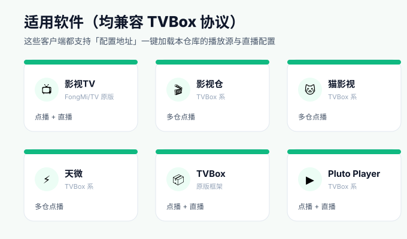
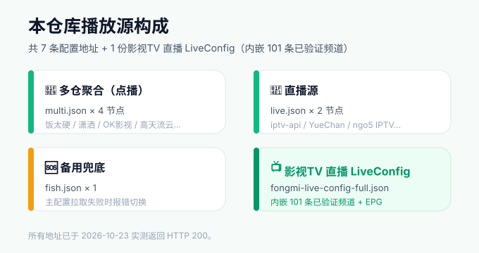
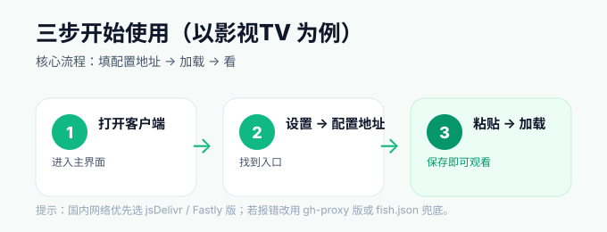
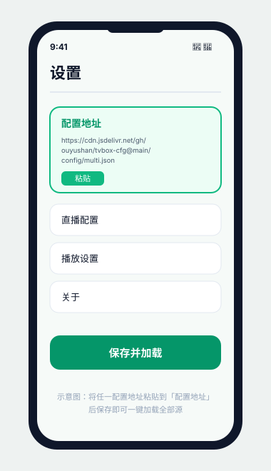

# Aberxy · 影视TV 播放源与直播配置合集

本仓库整合两类影视配置，全部适配 **影视TV（FongMi/TV）** 及兼容 TVBox 协议的客户端：

1. **7 条播放源配置地址**（点播多仓聚合 / 直播 / 备用兜底），逐条附用途与适用软件说明；
2. **影视TV 原生直播 LiveConfig**（`fongmi-live-config-full.json`，内嵌 **101 条已验证直播频道 + EPG 节目表**）。

> 所有地址已于 2026-10-23 实测返回 HTTP 200。
> 软件与配置仅供个人学习研究，不得商业分发或收费。

---

## 一、适用软件



这些客户端都支持「配置地址」一键加载本仓库的播放源与直播配置：

| 软件 | 类型 | 说明 |
|---|---|---|
| 影视TV（FongMi/TV） | 原版 | 点播 + 直播，本仓库首选 |
| 影视仓 / 猫影视 / 天微 | TVBox 系 | 多仓点播 |
| TVBox | 原版框架 | 点播 + 直播 |
| Pluto Player | TVBox 系 | 点播 + 直播 |

---

## 二、播放源配置地址（7 条）



### 多仓聚合（点播）— 同一 `multi.json`，4 个分发节点

| # | 名称 | 地址 | 用途 / 适用软件 | 备注 |
|---|---|---|---|---|
| 1 | jsDelivr CDN 版 | `https://cdn.jsdelivr.net/gh/ouyushan/tvbox-cfg@main/config/multi.json` | 点播主配置，加载饭太硬/潇洒/OK影视/高天流云等十余子源；影视TV、影视仓、猫影视、天微、TVBox、Pluto Player 等 | 国内直连首选 |
| 2 | jsDelivr Fastly 版 | `https://fastly.jsdelivr.net/gh/ouyushan/tvbox-cfg@main/config/multi.json` | 同内容，Fastly 节点 | CDN 版慢时备用 |
| 3 | 裸地址版 | `https://raw.githubusercontent.com/ouyushan/tvbox-cfg/main/config/multi.json` | 直连 GitHub 源 | 海外/代理环境用 |
| 4 | gh-proxy 反代版 | `https://gh-proxy.com/https://raw.githubusercontent.com/ouyushan/tvbox-cfg/main/config/multi.json` | 经 gh-proxy 反代，等价第 3 条 | 专治国内被墙 |

### 直播源 — `live.json`

| # | 名称 | 地址 | 用途 / 适用软件 | 备注 |
|---|---|---|---|---|
| 5 | jsDelivr CDN 版 | `https://cdn.jsdelivr.net/gh/ouyushan/tvbox-cfg@main/config/live.json` | 直播主配置，含 iptv-api(Guovin)/YueChan/ngo5 IPTV 等电视台；影视TV 直播入口、TVBox 系 | 国内直连首选 |
| 6 | 裸地址版 | `https://raw.githubusercontent.com/ouyushan/tvbox-cfg/main/config/live.json` | 直播裸源，内容同上 | 海外用 |

### 备用兜底 — `fish.json`

| # | 名称 | 地址 | 用途 / 适用软件 | 备注 |
|---|---|---|---|---|
| 7 | fish.json | `https://6800.kstore.vip/fish.json` | 完整 TVBox 配置（自带 spider jar + 站点片单），主配置拉取失败时报错切换 | 第三方托管，稳定性不如 jsDelivr 版 |

---

## 三、影视TV 直播 LiveConfig（内嵌 101 条已验证频道）

本仓库另提供一份可直接导入影视TV 的直播配置，含 3 个可切换直播源：

- **我的已验证存活源（101 条，内嵌）**：沙箱探测存活的直链，按分组内嵌，带台标 + EPG；
- **akiralereal 精选直连（大陆）**：拉取原仓库 `IPTV.m3u`；
- **akiralereal 海外直连（海外）**：拉取原仓库 `IPTV-overseas.m3u`。

EPG 节目表：`http://epg.112114.xyz/pp.xml`（XMLTV，已验证可用）。

**直接复制下面的配置地址导入影视TV 即可：**

```
https://raw.githubusercontent.com/vgmr-99/Aberxy/main/fongmi-live-config-full.json
```

> 注：纬来日本/纬来育乐两条为 RTMP，能否播放取决于播放核心（ijkplayer 支持、exoplayer 不支持）；其余均为 HLS/HTTP。

---

## 四、三步配置教程（以影视TV 为例）





1. **打开客户端 → 设置 → 配置地址**：在主界面进入「设置」，找到「配置地址 / 订阅地址」入口。
2. **粘贴地址 → 保存**：点播复制上方「多仓聚合」任一地址（国内推荐 **第 1 条 jsDelivr CDN 版**），直播复制 **第 5 条 live.json（jsDelivr 版）**，或在支持多线路的客户端里再追加一条 live.json。
3. **加载完成即可观看**：等待加载完成即可看到全部点播源与直播频道。

> 若提示「配置拉取失败 / 加载错误」，改用 **gh-proxy 版**（第 4 条）或 **fish.json 备用源**（第 7 条）兜底。

---

## 免责声明

本仓库仅作信息聚合，所有播放源内容版权归原作者所有。源内容随时可能变动或失效，请自行判断可用性。软件与配置仅供个人学习研究，不得用于商业分发或收费。
